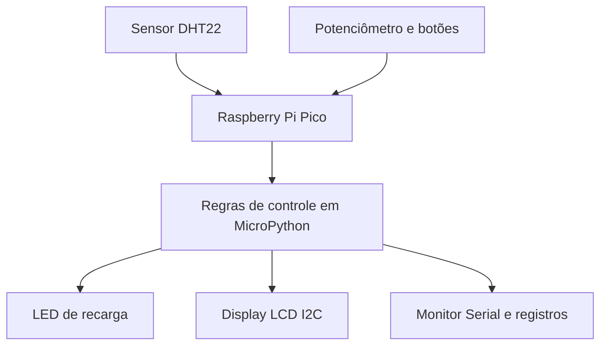

# ChargeGrid-Intelligence-Sprint-Python
Protótipo de gerenciamento inteligente de recarga de veículos elétricos com Raspberry Pi Pico, MicroPython e simulação no Wokwi.

# ChargeGrid Intelligence — Sprint Python

## 1. Identificação do projeto

**Projeto:** ChargeGrid Intelligence — Sistema inteligente de gerenciamento de recarga de veículos elétricos  
**Disciplina:** Python  
**Equipe:**    Mateus Felipe Curtale Serafim ( RM:571129), Rafael Almeida Rebello (RM:570642), Maria Beatriz Braga de Lima(RM:570501), Julia Nunes Frederici (RM:569858), Vinicius Sanches Chiarle (RM:568846)

**Tecnologias principais:** Raspberry Pi Pico, MicroPython, Wokwi e Python.

## 2. Contextualização

A expansão da mobilidade elétrica aumenta a necessidade de soluções que permitam gerenciar a recarga de veículos com segurança e eficiência energética.

O ChargeGrid Intelligence é um protótipo acadêmico inspirado no desafio tecnológico da GoodWe. Ele demonstra como sensores, automação e monitoramento podem ser utilizados para controlar a autorização de uma sessão de recarga de veículo elétrico de acordo com a temperatura e a disponibilidade simulada de energia solar.

O sistema foi desenvolvido e testado em ambiente virtual utilizando o simulador Wokwi e o Raspberry Pi Pico com MicroPython.

## 3. Problema e objetivo

O problema abordado é como evitar que uma recarga seja autorizada quando as condições monitoradas não atendem aos critérios definidos pelo sistema.

Os objetivos são:
- Monitorar a temperatura por meio do sensor DHT22.
- Simular a disponibilidade de energia solar.
- Controlar a autorização da recarga por regras condicionais.
- Informar o estado do sistema por meio de um display LCD.
- Indicar a condição de recarga utilizando um LED.
- Registrar informações das sessões no Monitor Serial.

## 4. Arquitetura e integração

O Raspberry Pi Pico executa o programa em MicroPython e coordena os componentes do protótipo.

O DHT22 fornece a leitura de temperatura. Um potenciômetro e os botões permitem simular e ajustar a disponibilidade de energia solar. O programa avalia as condições e atualiza o LED, o LCD e o Monitor Serial.

### Fluxo de funcionamento

1. Inicialização do sistema e do display.
2. Leitura da temperatura.
3. Verificação da conexão do veículo.
4. Avaliação da disponibilidade de energia solar.
5. Aplicação das regras de autorização da recarga.
6. Atualização dos indicadores visuais.
7. Registro das informações da sessão ao desconectar o veículo.

### Diagrama de arquitetura

## 5. Componentes e tecnologias

| Componente ou tecnologia | Função |
|---|---|
| Raspberry Pi Pico | Unidade de controle |
| MicroPython | Linguagem utilizada no microcontrolador |
| DHT22 | Monitoramento da temperatura |
| Potenciômetro | Simulação da disponibilidade de energia |
| Botões | Conexão do veículo e ajuste da energia simulada |
| LED | Indicação visual da autorização da recarga |
| LCD I2C 16x2 | Exibição de mensagens e estado operacional |
| Wokwi | Simulação do circuito e do programa |
| GitHub | Versionamento e documentação do projeto |

## 6. Regras de controle

O protótipo utiliza os seguintes parâmetros:

- Energia solar mínima simulada: 3,0 kW.
- Temperatura máxima permitida: 40 °C.
- Potência de referência para estimativa: 3,3 kW.
- Energia solar simulada ajustável entre 0 e 6 kW.

A recarga é autorizada quando o veículo está conectado, a temperatura está dentro do limite e a energia simulada é igual ou superior a 3,0 kW.

Quando a temperatura ultrapassa o limite ou a energia fica abaixo do mínimo, o sistema desliga o LED de recarga e apresenta uma mensagem de bloqueio no LCD.

Essas regras representam uma demonstração acadêmica e não substituem os sistemas de proteção e controle de um carregador real.

## 7. Resultados e testes do protótipo

### 7.1. Metodologia de teste

Os testes foram realizados no simulador Wokwi, utilizando o Raspberry Pi Pico programado em MicroPython. O objetivo foi verificar o comportamento do sistema diante de diferentes condições de conexão do veículo, temperatura e disponibilidade simulada de energia solar.

Os resultados foram observados por meio do display LCD, do LED indicador e das mensagens apresentadas no Monitor Serial.

### 7.2. Teste 1 — Inicialização do sistema

**Objetivo:** verificar se o programa inicia e inicializa os componentes.

**Procedimento:** iniciar a simulação no Wokwi e observar as mensagens do terminal e do display LCD.

**Resultado observado:** o sistema apresenta a mensagem de inicialização e, após esse processo, começa a monitorar as condições de funcionamento.

**Status:** funcionamento observado durante a execução da simulação.

### 7.3. Teste 2 — Recarga normal

**Objetivo:** verificar se a recarga é autorizada quando as condições configuradas são atendidas.

**Condições registradas:**
- Temperatura: 24,0 °C.
- Energia solar simulada: 5,0 kW.
- Veículo: conectado.
- Temperatura abaixo do limite de 40 °C.
- Energia disponível acima do mínimo de 3,0 kW.

**Resultado observado:** o Monitor Serial apresentou o estado `RECARGA ATIVA`, e o LCD exibiu a mensagem `SOL: 5.0 kW` e `RECARGA: ATIVA`.

**Conclusão:** o comportamento registrado corresponde às regras de autorização implementadas no protótipo.

### 7.4. Teste 3 — Energia solar insuficiente

**Objetivo:** verificar se o sistema bloqueia a recarga quando a energia simulada fica abaixo do mínimo configurado.

**Procedimento:** com o veículo conectado, reduzir a energia solar simulada para um valor inferior a 3,0 kW.

**Resultado esperado:** o LCD apresenta `ENERGIA BAIXA` e `RECARGA OFF`, e o LED indicador é desligado.

**Resultado observado:** com o veículo conectado, a temperatura em 24,0 °C e a disponibilidade de energia solar simulada em 2,5 kW, o sistema identificou que a energia estava abaixo do mínimo de 3,0 kW. O LCD apresentou ENERGIA BAIXA e RECARGA OFF, enquanto o Monitor Serial exibiu STATUS: ENERGIA BAIXA. O registro da sessão também indicou ENERGIA BAIXA.

**Status:** aprovado — comportamento esperado observado na simulação.

### 7.5. Teste 4 — Temperatura elevada

**Objetivo:** verificar o bloqueio da recarga quando a temperatura ultrapassa o limite configurado.

**Procedimento:** ajustar o sensor simulado para apresentar uma temperatura superior a 40 °C, mantendo o veículo conectado e a energia solar acima do mínimo.

**Resultado esperado:** o LCD apresenta `TEMP. ALTA!` e `RECARGA OFF`, e o LED indicador é desligado.

**Resultado observado:** a temperatura atingiu 45,8 °C, ultrapassando o limite configurado de 40 °C. Com o veículo conectado e a energia solar simulada em 5,0 kW, o sistema apresentou TEMP. ALTA! e RECARGA OFF no display LCD. O Monitor Serial confirmou o estado TEMP. ALTA, e o LED de recarga permaneceu desligado.

**Status:** aprovado — comportamento esperado observado na simulação.

### 7.6. Teste 5 — Desconexão do veículo

**Objetivo:** verificar o encerramento da sessão quando o veículo é desconectado.

**Procedimento:** iniciar uma sessão de recarga e, em seguida, pressionar o botão utilizado para desconectar o veículo.

**Resultado esperado:** o sistema encerra a sessão, calcula a duração e apresenta no Monitor Serial os dados registrados, incluindo a energia estimada e o resultado da sessão.

**Resultado observado:** [Preencher após executar o teste.]

**Status:** pendente de confirmação.

### 7.7. Teste 6 — Registro de dados

**Objetivo:** verificar se o programa apresenta os dados da sessão em formato estruturado.

**Resultado observado:** foi registrada no Monitor Serial uma linha com campos separados por ponto e vírgula, contendo informações da sessão, temperatura, energia solar, energia estimada e resultado.

Exemplo observado:

`2;16.3;24.0;5.0;0.0146;RECARGA NORMAL`

O registro é exibido no terminal e pode ser copiado para análise posterior. O programa atual não cria automaticamente um arquivo CSV permanente.

### 7.8. Síntese dos resultados

O teste de recarga normal comprova o funcionamento das regras de autorização em um cenário com energia suficiente e temperatura abaixo do limite. O programa também contém regras específicas para bloquear a recarga em condições inadequadas e registrar informações das sessões.

Os testes de energia insuficiente, temperatura elevada e desconexão devem ser executados e documentados para confirmar integralmente esses comportamentos.

Os resultados correspondem a uma simulação acadêmica. Não representam medições de um carregador comercial nem comprovam economia real de energia.

## 8. Alinhamento ao desafio GoodWe

O projeto se relaciona ao desafio de gerenciamento inteligente de recarga ao demonstrar monitoramento, controle automatizado e acompanhamento do estado operacional.

A simulação de energia solar representa uma forma simplificada de estudar como a disponibilidade energética pode influenciar a autorização da recarga.

O protótipo não está conectado a equipamentos GoodWe reais e não implementa cobrança, comunicação comercial entre carregadores ou inteligência artificial. Esses recursos são possibilidades de evolução futura.

## 9. Conexão com a disciplina de Python

O projeto aplica conceitos de programação, incluindo:
- Variáveis e constantes.
- Estruturas condicionais (`if`, `elif` e `else`).
- Laços de repetição (`while`).
- Funções.
- Tratamento de exceções (`try` e `except`).
- Dicionários e listas para organizar dados das sessões.
- Leitura de entradas e controle de saídas.
- Manipulação de tempo e apresentação de dados no terminal.

## 10. Sustentabilidade e inovação

O protótipo demonstra o potencial da automação para condicionar a recarga à disponibilidade simulada de energia solar. Essa abordagem pode contribuir para estudar o uso mais consciente da energia em sistemas de mobilidade elétrica.

A principal contribuição sustentável é a demonstração de uma estratégia de controle energético em ambiente simulado, sem necessidade de montar fisicamente todo o circuito para os testes iniciais.

Entretanto, não foram realizadas medições reais de economia de energia, redução de emissões ou eficiência de um carregador comercial. Portanto, esses benefícios são potenciais e precisam de validação em um sistema real.

## 11. Limitações e melhorias futuras

- Integração com sensores e fontes reais de energia.
- Armazenamento persistente dos dados em CSV.
- Implementação de comunicação com um backend.
- Gestão de múltiplos veículos e carregadores.
- Integração com protocolos de carregamento compatíveis.
- Mecanismos reais de tarifação e pagamento.
- Uso de modelos de inteligência artificial para análise de dados.

## 12. Como executar a simulação

1. Acesse o projeto no Wokwi.
2. Inicie a simulação.
3. Utilize os botões para conectar ou desconectar o veículo e ajustar a energia solar simulada.
4. Observe o LCD, o LED e as mensagens do Monitor Serial.

**Projeto Wokwi:** https://wokwi.com/projects/475558937320053761

## 13. Vídeo de demonstração

**YouTube:** https://youtu.be/XQKPGsQNUf4

## 14. Repositório

O código e a documentação do projeto estão disponíveis neste repositório GitHub.
